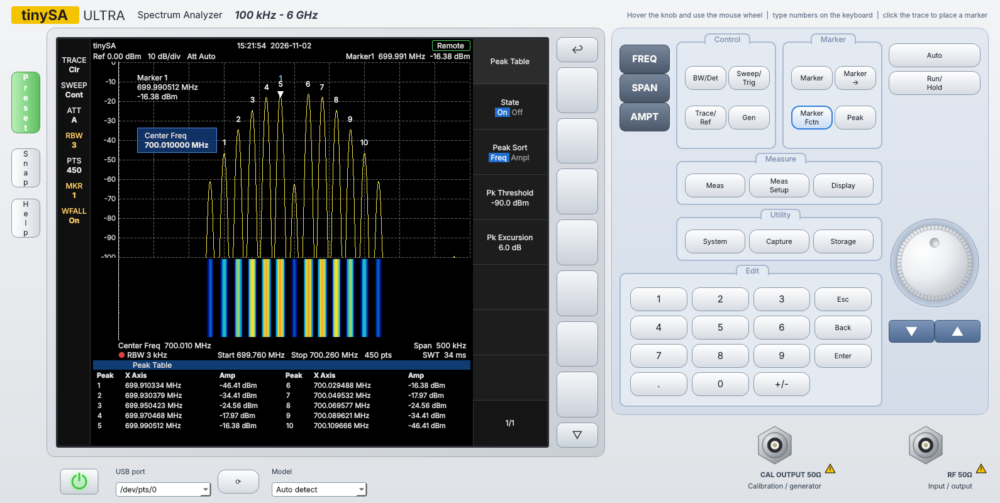
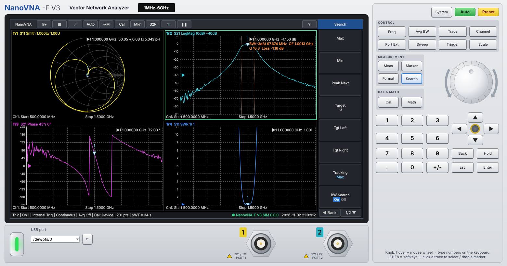

# TinySA & NanoVNA Front Panels for Windows

USB interface programs for the tinySA and the NanoVNA, with graphical instrument panels controlled by the mouse.

Demo videos on YouTube: [tinySA](https://youtu.be/yPIbrWnYdHI) | [NanoVNA](https://youtu.be/Vf9LRCsLcrs)

## Overview

Bench-instrument style Windows front panels for low-cost RF test gear, written in Python (PyQt6 + pyqtgraph).
Each one talks to the instrument over its USB serial shell and includes a simulator, so you can try it without hardware.

| Tool | Instrument | Highlights |
|---|---|---|
| [tinySA Front Panel](tinysa_panel/) | tinySA Ultra / tinySA | Live trace, markers, peak table, max/min hold, averaging, waterfall, generator, screen capture |
| [NanoVNA-F V3 Front Panel](nanovna_panel/) | SYSJOINT NanoVNA-F V3 (NanoVNA shell) | 4 traces, Smith/polar/LogMag/phase/GD/SWR/TDR, markers + BW/Q search, app-side SOLT cal, Touchstone export |





## Download

Ready-to-run Windows programs (no Python needed), `tinySA_Panel.exe` and `NanoVNA_Panel.exe`,
are attached to each version on the [Releases](../../releases) page. If no release is listed yet,
run from source (below) or build the .exe yourself.

## Run from source

1. Install Python 3.10 or newer (tick "Add Python to PATH").
2. Open the tool's folder and double-click `run.bat`. The first run installs the dependencies.
   `run_simulator.bat` starts it with the built-in simulator.

```
pip install -r tinysa_panel/requirements.txt
python tinysa_panel/tinysa_panel.py --sim
python nanovna_panel/vna_panel.py --sim
```

## Common controls

- Hard keys open softkey menus on the screen. Click a softkey or use F1-F8 (F1-F7 on the tinySA panel).
- **Knob:** hover over it and use the mouse wheel, or click and drag.
- **Entering values:** type a number on the keypad or the PC keyboard, then pick a unit softkey or press Enter.
- **Markers:** click the trace to drop the active marker.

## Building the .exe yourself

Run `build_exe.bat` in either folder. The program ends up in that folder's `dist\` subfolder.
Pushing a tag such as `v1.0` to GitHub builds both programs automatically and attaches them to a release
(see `.github/workflows/build.yml`).

## License

MIT. See [LICENSE](LICENSE).
