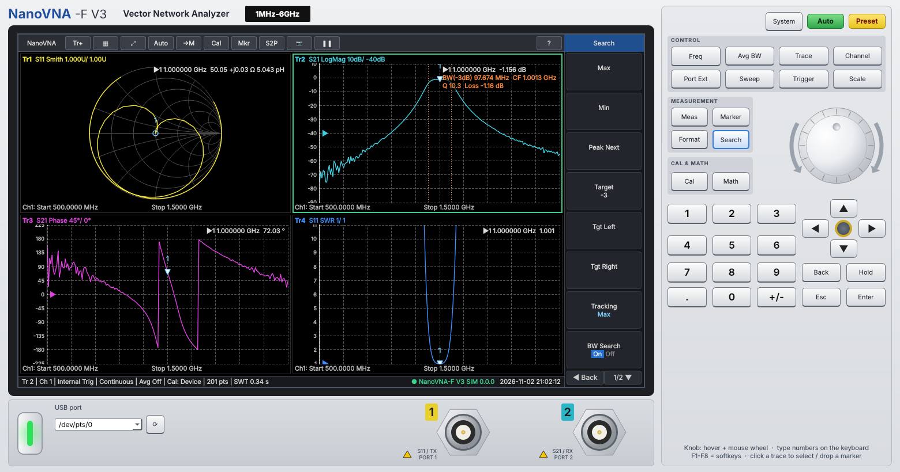

# NanoVNA-F V3 Front Panel

Bench-VNA style Windows remote panel for the SYSJOINT NanoVNA-F V3 (and other NanoVNA-shell devices).

## Run
1. Install Python 3.10+ (tick "Add to PATH").
2. `run.bat` connects to the NanoVNA (auto-detected, VID 0483 / PID 5740).
   `run_simulator.bat` runs without hardware (a 1 GHz 3-pole bandpass DUT with realistic port errors).
   `build_exe.bat` makes `dist\NanoVNA_Panel.exe`.

Command line: `python vna_panel.py [--sim] [--port COM9]`

## Panel
- **Keys**: System / Auto (autoscale all) / Preset; CONTROL: Freq, Avg BW, Trace, Display, Port Ext, Sweep, Trigger, Scale;
  MEASUREMENT: Meas, Marker, Format, Search; CAL & MATH: Cal, Math. Menus appear on the right of the screen (F1-F8 too).
- **Knob**: hover + mouse wheel or drag. ◀ ▶ = fine, ▲ ▼ = coarse. Keypad or PC keyboard + unit softkey / Enter.
- **Traces**: up to 4, each S11 or S21 in LogMag, Phase, Group Delay, Smith, Polar, SWR, LinMag, Real, Imag,
  Unwrapped Phase, |Z|, R, X, TDR. Click a panel to select it; click its plot to drop the active marker.
- **Markers**: 4, readout per trace (Smith shows R+jX and equivalent L/C). Search: max/min/peak next/target,
  tracking, and -N dB bandwidth with center frequency and Q.
- **Math**: Data→Mem, Data/Mem, display Data/Mem/both, Touchstone file into memory, smoothing.
- **Port Ext**: electrical delay (Auto Delay from phase slope), phase offset, velocity factor for TDR.
- **Files**: S1P, S2P (S12/S22 written as 0), CSV, PNG, device screen capture, raw console.

## Calibration
- **Correction = Device**: uses the NanoVNA's own calibration (`cal on`). Recall/save device slots 0-6 from the Cal menu.
- **Correction = App**: the device is put in `cal off` and the app corrects raw data:
  Open, Short, Load on port 1; Thru port 1→2; optional Isolation (load both ports); then Done/Apply.
  Each standard averages *Cal Averages* sweeps. Ideal standards are assumed (no cal-kit coefficients).
  Narrowing the sweep inside the cal range interpolates the error terms (status shows "interp").
  Save/Load Cal stores the raw standards (.npz).
- Error model: 3-term one-port + enhanced-response transmission (the NanoVNA is a 1.5-port instrument,
  so port-2 match is only partly corrected; that is the same limit the firmware has).

## Protocol notes
- `scan start stop points 7` → text lines `freq s11re s11im s21re s21im`. Older firmware without the mask
  falls back to `data 0` / `data 1` / `frequencies`.
- Sweeps longer than the device allows are split into segments (Sweep → Segment, default 201;
  it drops to 101 automatically if the device rejects 201).
- `capture` is read as 800x480 RGB565 little-endian.
