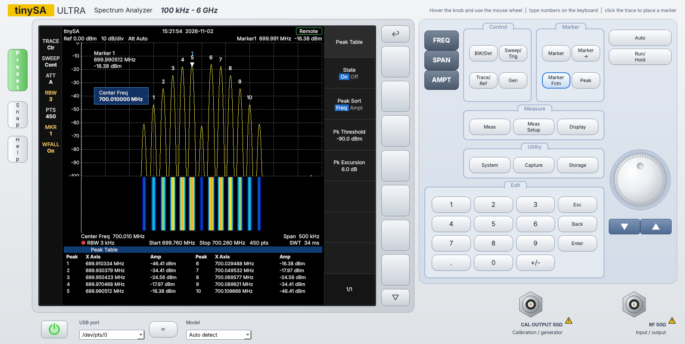

# tinySA Front Panel

Bench-analyzer style Windows remote panel for the tinySA Ultra (and original tinySA).

## Run
1. Install Python 3.10+ from python.org (tick "Add to PATH").
2. Double-click `run.bat` (installs PyQt6, pyqtgraph, numpy, pyserial on first run).
   - `run_simulator.bat` runs it without hardware.
   - `build_exe.bat` makes a standalone `dist\tinySA_Panel.exe`.

Command line: `python tinysa_panel.py [--sim] [--port COM7] [--model ultra|basic]`

The tinySA is found automatically (USB VID 0483 / PID 5740). The model is detected from `version`
(`tinySA4...` = Ultra).

## Using it
- **Hard keys** (FREQ, SPAN, AMPT, BW/Det, Marker, Peak...) open softkey menus on the screen.
- **Softkeys**: grey keys beside the screen, the on-screen labels, or F1-F7.
- **Knob**: hover and use the mouse wheel, or click-drag. Up/Down keys work too.
- **Arrows**: coarse steps (PgUp/PgDn).
- **Keypad / PC keyboard**: type a value, then pick a unit softkey (GHz/MHz/kHz/Hz) or Enter (MHz).
- Click the trace to drop the selected marker. With no active parameter, the knob moves the marker.
- **Auto**: full span, then zooms on the strongest signal. **Run/Hold** freezes the sweep.
- **Gen**: signal-generator output (sweeping pauses while it is on).
- **System -> Console**: raw shell commands. **Capture -> Device Screen**: grabs the tinySA LCD.

## Protocol notes
- `scanraw start stop points` -> `{` + points x (`x` + uint16 LE) + `}`; dBm = raw/32 - 174 on the Ultra
  (128 on the Basic). If absolute levels look off, adjust System -> Level Offset.
- RBW, attenuation, LNA, spur removal, and input mode are sent to the device. Ref level, scale,
  ref offset, trace modes (max/min hold, power average), markers, peak table, and waterfall run in the app.

## Files
- `tinysa_panel.py` - UI, menus, trace processing
- `device.py` - serial protocol, simulator, worker thread
- `widgets.py` - painted knob, power key, connectors
